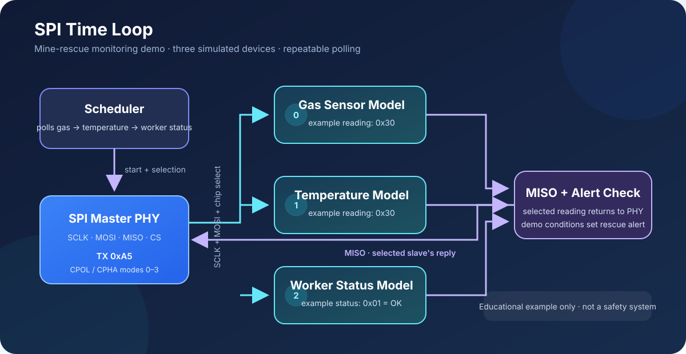
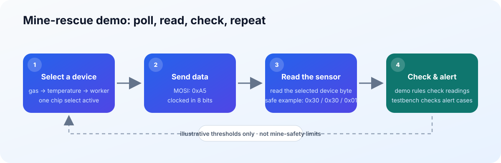

# SPI Time Loop

A Verilog project that simulates one SPI controller polling three mine-rescue
monitoring devices. It is designed and tested in **Xilinx Vivado 2023.2**.
This project is simulation-only; it does not require a physical FPGA board.

## At a glance

## Mine-rescue simulation

The project demonstrates a controller checking three simulated monitoring
devices in sequence. It sends `0xA5` to each device and reads an 8-bit example
value back over SPI:

| Device | Safe example value | Meaning in this demo |
| --- | --- | --- |
| Gas sensor | `0x30` | Below the demo warning level |
| Temperature sensor | `0x30` | Below the demo warning level |
| Worker status | `0x01` | Worker status is OK |

The scheduler polls the devices in order: **gas → temperature → worker
status**. The PHY supports all four SPI modes, set by clock polarity (`CPOL`)
and clock phase (`CPHA`).

The sensor bytes are raw example codes in the simulation; they are not
calibrated into physical gas-concentration or temperature units.

### Demo alert rules

The top-level design records the readings and sets a sticky `rescue_alert` if:

- The gas reading is `0x40` or higher.
- The temperature reading is `0x40` or higher.
- The worker status is not `0x01` (OK); `0x00` represents distress.

The alert clears on reset. These byte values and thresholds are **illustrative
simulation settings, not real mine-safety limits**. This educational project
does not read physical sensors, locate workers, or provide a safety or rescue
system. Its integration testbench runs a safe example plus gas-warning,
temperature-warning, and worker-distress examples.

The default top-level parameters provide the safe example values. The
integration testbench also creates parameterized copies of the design with
each alert condition enabled, so the alert paths can be checked in one run.

## How the design is organized

- **SPI PHY (`spi_phy_m2.v`)** — Generates the SPI clock, selects a slave,
  transmits and receives data, and applies configurable timing.
- **Scheduler (`spi_scheduler.v`)** — Starts one transfer per slave and waits
  for each transfer to finish before selecting the next one.
- **Top-level design (`spi_time_loop_top.v`)** — Connects the PHY, scheduler,
  and simulated gas, temperature, and worker-status devices. It records the
  replies and raises the demo alert when a configured condition is met.
- **Slave model (`spi_slave_mode_model.v`)** — Simulates a slave's SPI response.
- **Testbenches** — Drive the design in simulation and check its behavior.

## Run the simulations

1. Open `SPI_TIME_LOOP.xpr` in Vivado.
2. In **Flow Navigator**, select **Simulation → Run Simulation → Run
   Behavioral Simulation** to run the configured top-level integration test.
3. To run another testbench, find it under **Simulation Sources**, right-click
   it, select **Set as Top**, then run **Run Behavioral Simulation**:
   - `spi_phy_m2_tb` tests the PHY.
   - `spi_scheduler_tb` tests the scheduler.
   - `spi_time_loop_top_tb` tests the full design.

## Verification status

| Test | Current result |
| --- | --- |
| PHY data transfer | Passed MOSI (`0xA5`) and MISO (`0x3C`) checks in all four SPI modes. |
| PHY zero timing values | Passed: zero values are flagged as clamped, and the transfer completes with the expected reply. |
| PHY reset during transfer | Passed: reset aborts the active transfer and clears the checked outputs. |
| PHY nonzero timing values | Timing assertions have been added for the SCLK divider and chip-select setup, hold, and gap. **Run this updated testbench in Vivado to confirm the result.** |
| Scheduler | Passed: three transfers completed, including a test pulse of `enable` while busy. |
| Mine-rescue integration | Passed: the safe scenario reported gas `0x30`, temperature `0x30`, worker OK, and no alert. Gas-warning, temperature-warning, worker-distress, and alert-reset checks also passed. |

## Project files

- `SPI_TIME_LOOP.srcs/sources_1/new/` — Design modules.
- `SPI_TIME_LOOP.srcs/sim_1/new/` — Simulation models and testbenches.
- `docs/diagrams/` — README architecture and transaction illustrations.
- `SPI_TIME_LOOP.xpr` — Vivado project file.

## Tools

- Xilinx Vivado 2023.2 (includes the simulator used by this project)
- Verilog HDL

## License

No license has been specified yet.
